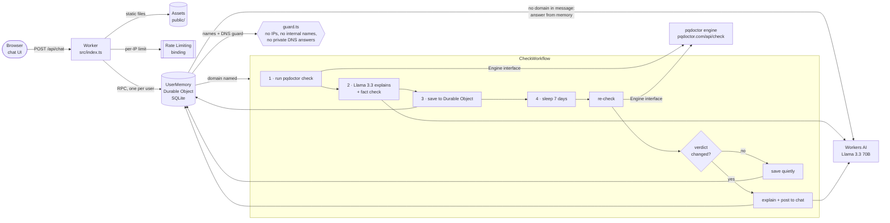

# pqdoctor Chat

Ask in plain English whether a server is post-quantum ("is example.com post-quantum? we run nginx").
The [pqdoctor](https://pqdoctor.com) engine checks it with real TLS handshakes. Llama 3.3 on Workers AI
explains the result and writes pqdoctor's fix for your stack. A week later it checks again and tells
you if anything changed.

**Live:** https://cf-ai-pqdoctor-chat.gopalam-k.workers.dev

Built on Cloudflare: **Workers**, **Workers AI** (Llama 3.3 70B), **Workflows**, **Durable Objects**
(SQLite) and **static assets** for the chat UI.

## The LLM explains, the engine decides

Language models are good at explaining and bad at being right about a specific server. So the model
never gets to decide anything here:

- **The verdict, cause and fix come only from the engine.** pqdoctor sends seven hand-made
  ClientHellos and reads what the server answers. Its JSON result (`verdict`, `cause`, `fixes[]`) is
  the source of truth. The chat card shows those fields directly, labelled "pqdoctor engine".
- **Llama only sees the engine's JSON** (plus your stack), never the server, and is told to restate
  the verdict, explain the cause and adapt one of the engine's fixes to your stack, keeping the same
  values.
- **What Llama writes gets checked** ([`src/explain.ts`](src/explain.ts) `checkExplanation`) before
  anyone sees it. It's rejected if it:
  - calls a non-PQ server post-quantum, or a PQ server not post-quantum;
  - names a key-exchange group the engine didn't (e.g. `SecP384r1MLKEM1024`);
  - quotes a version number the engine didn't (e.g. "upgrade nginx to 1.27");
  - recommends a product or library that's in neither the engine's fixes nor your stack.

  A rejected answer is replaced by the engine's own words, and the card says why.
- **Even the parsing is deterministic.** Hostnames and stack names are pulled from your message with
  plain code ([`src/parse.ts`](src/parse.ts)), so the guardrails see every name before any model
  does.

Adapting is allowed, inventing isn't. When pqdoctor says `Groups = X25519MLKEM768:X25519:prime256v1`
and you run nginx, Llama may write `ssl_ecdh_curve X25519MLKEM768:X25519:prime256v1;`: same fix, same
values, your syntax. If it wrote "upgrade to nginx 1.27" instead, that version comes from the model
and not the engine, so the check refuses it.

## Architecture



| Piece | File | Job |
| --- | --- | --- |
| Worker | [`src/index.ts`](src/index.ts) | `/api/*` routes, anonymous user cookie, same-origin check, per-IP limit |
| Durable Object | [`src/memory.ts`](src/memory.ts) | One per user. SQLite tables: `messages` (chat history), `results` (every check with full engine JSON and timestamp), `domains` (last verdict, re-check date, workflow id), `profile` (your stack), `hits` (rate limits) |
| Workflow | [`src/workflow.ts`](src/workflow.ts) | check → explain → save → `step.sleep("7 days")` → re-check → post only if the verdict changed |
| Engine | [`src/engine.ts`](src/engine.ts) | `Engine.check(host)` behind one interface; `httpEngine` calls pqdoctor.com today |
| Explainer | [`src/explain.ts`](src/explain.ts) | Prompt, Workers AI call, `checkExplanation`, fallback to the engine's words |
| Guardrails | [`src/guard.ts`](src/guard.ts) | Hostname rules, private/reserved IPv4 + IPv6 ranges, DNS-over-HTTPS check |
| UI | [`public/`](public) | Plain HTML/CSS/JS chat with a memory panel; server text only ever goes in through `textContent` |

### Why each piece

- **Durable Object per user = memory.** All of one user's state lives in one place with strong
  consistency and no database to run. The chat, the workflow and the re-check all talk to the same
  object by name (`getByName(userId)`).
- **Workflows for the check.** Each step's result is persisted, so a deploy or crash mid-check
  resumes where it stopped. The engine call retries on 429/5xx with exponential backoff but not on
  a refused name (`NonRetryableError`). The 7-day `step.sleep` costs nothing while it waits.
- **One watch per domain.** Asking about a domain again terminates its old workflow and starts a
  new one, so there's never more than one pending re-check per domain. "Forget everything" deletes
  the Durable Object's storage and terminates its workflows; a re-check that wakes up after that
  finds no domain and ends quietly.
- **The engine behind one function.** `engineFor(env)` in `workflow.ts` is the only place an engine
  is chosen. pqdoctor's engine is Rust compiled to WebAssembly, so a local `wasmEngine` (raw
  `cloudflare:sockets` + the same `.wasm`) would be one new `Engine` implementation, with nothing
  else changing.

## Guardrails

- **No private or internal targets.** Refused before anything is sent to the engine: IP literals
  (IPv4, IPv6, `127.1`, `0x7f000001`), single-label names, and reserved/internal suffixes
  (`localhost`, `.local`, `.internal`, `.lan`, `.home.arpa`, `.corp`, `.test`, `.onion`, ...). Then the
  name is resolved over DNS-over-HTTPS, and it's refused if **any** A/AAAA answer is private,
  loopback, link-local (incl. `169.254.169.254`), CGNAT, documentation, multicast, or an IPv4-mapped,
  NAT64 or 6to4 form of one. So `localtest.me` (a public name for 127.0.0.1) is refused.
  Only port 443.
- **Rate limits.** Per user (in the Durable Object): 10 checks an hour (`CHECKS_PER_HOUR`) and 30
  messages per 10 minutes. Per IP (Workers Rate Limiting binding): 30 requests a minute, so clearing
  the cookie doesn't buy more checks.
- **Requests.** Writes must be `application/json` from the same origin. Messages are capped at 600
  characters, and the user cookie is `HttpOnly; SameSite=Strict`.
- **The model's scope.** Free-form questions go to Llama with your memory (stack, past verdicts with
  dates) and a system prompt that forbids guessing a verdict it wasn't given.

## Run it

You need Node 20+ and a Cloudflare account (Workers AI runs remotely even in local dev, so
`npx wrangler login` first).

```bash
npm install
cp .dev.vars.example .dev.vars   # re-check after 2 minutes instead of 7 days
npm run dev                      # http://localhost:3105
```

Then try:

- `is github.com post-quantum? we run nginx`: not PQ; the fix comes back in nginx syntax
- `check google.com`: post-quantum (X25519MLKEM768)
- `check localtest.me` or `check 10.0.0.1`: refused
- `what did you find for github.com last time?`: answered from the Durable Object, no new check

```bash
npm test          # 79 unit tests: guardrails, parsing, engine normalisation, the fact check
npm run typecheck
```

The engine tests use real pqdoctor.com answers saved in `test/fixtures/`.

## Deploy

```bash
npx wrangler deploy
```

This creates the Worker, the Durable Object class, the Workflow and the rate limiter from
`wrangler.jsonc`. No secrets are needed. `RECHECK_AFTER` defaults to `7 days` and `CHECKS_PER_HOUR`
to `10`.

## Limits and honesty

- Checks run from Cloudflare's network, so a server that answers Cloudflare's IPs differently from
  yours could get a different verdict than you'd see locally. The `verify` command on each card
  (`openssl s_client ... -groups X25519MLKEM768`) lets you confirm from your own machine.
- Names on Cloudflare's own network are reported as "post-quantum at Cloudflare's edge" without
  probing: the edge already negotiates X25519MLKEM768, and the origin behind it can't be seen from
  outside.
- The fact check is deliberately strict. A false rejection only costs a less friendly sentence
  (you get the engine's words); a false pass would cost trust.
- Users are anonymous (a random id in a cookie). Clearing cookies starts a new memory.

## Prompts

The prompts used to build this are in [PROMPTS.md](PROMPTS.md), along with the system prompts
the app sends to Llama 3.3.
